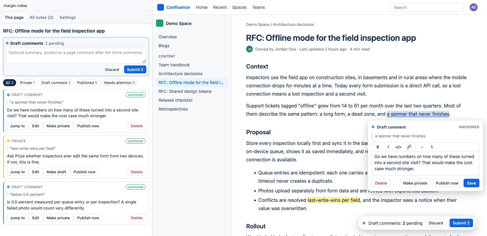

# margin-notes

A personal Firefox extension for private notes on Confluence Cloud pages, anchored to the text they're about. A note can stay private forever, or become a **draft comment** that is published as a native Confluence inline comment, either on its own (**Publish now**) or together with others in one batch (**Submit**), GitHub-review style. Nobody is notified until you publish.



Background, research and design: [idea.md](idea.md), [research.md](research.md) and the `appendix-*.md` files.

## Getting started

### Prerequisites

- Firefox 150 or newer
- Node.js (current LTS) and npm
- A Confluence Cloud site on `*.atlassian.net` you are logged in to

### Install

```sh
git clone git@github.com:SimonBaeumer/confluence-margin-notes.git
cd confluence-margin-notes
npm install
```

### Load the extension

**Quickest:** `npm run dev` starts a fresh Firefox profile with the extension loaded and reloads it on every change.

**In your own Firefox profile (until restart):**

1. `npm run build` (output in `.output/firefox-mv3`).
2. Open `about:debugging#/runtime/this-firefox` and click **Load Temporary Add-on...**.
3. Select `.output/firefox-mv3/manifest.json`.

Temporary add-ons are removed when Firefox closes. To keep it installed without publishing it to the store, see [Installing permanently](#installing-permanently).

### Grant site access

Firefox does not grant host permissions to Manifest V3 add-ons at install time. Open a Confluence page, click the extensions button in the toolbar and allow margin-notes on `*.atlassian.net` (or enable it under `about:addons` > margin-notes > **Permissions**). Then reload the page and select some text to add your first note.

## Using it

- **Select text** on a Confluence page (view mode), then click **Add note** (or press `Alt+Shift+M`, or use the context menu). Write the note and choose:
  - **Keep private**: yellow highlight, never published.
  - **Add draft comment**: blue highlight, collected for the next submit.
  - **Publish now**: posted as an inline comment right away.
- **Click a highlight** to edit the note, switch it between private and draft, publish it, or delete it.
- The **Draft comments** pill at the bottom right shows how many drafts are pending. **Submit** opens a dialog with every draft in document order and an optional summary (posted as a page comment after the inline comments). **Discard** turns all drafts back into private notes; nothing is deleted.
- The **sidebar** (toolbar button or `Alt+Shift+N`) lists the notes on the current page with filters, shows notes that need attention (text changed, ambiguous, orphaned), lets you re-attach them to a new selection, and has an **All notes** view across pages plus JSON export/import.

### Staying on the right text

Each note stores the block `localId`, the page version, the quote with 64 characters of context and its offsets, all in Confluence's own ADF text model. On every load it is re-found through a cascade (same version, block id, version diff, fuzzy quote search) and shows its result: **anchored**, **moved**, **changed** ("was: …"), **ambiguous** or **orphaned**.

Publishing re-checks every note against the latest page right before its POST. Anchored and moved notes publish directly, changed ones need a confirmation, ambiguous and orphaned ones are blocked. The occurrence index Confluence needs is computed from that same fresh snapshot. Nothing is ever published on uncertain text.

## Verified on example.atlassian.net (2026-10-02, Firefox 154)

The open spike questions from [idea.md](idea.md), answered on a sandbox copy of an RFC (page `2073722940`):

| Question | Answer |
|---|---|
| Does a content-script POST pass the XSRF check? | Yes. Same-origin `fetch` with the session cookie works; no token needed. |
| Error bodies for a bad selection? | Text not found, wrong match count and index out of range all return the same `400 {"errors":[{"code":"BAD_REQUEST","title":"Can not create inline comment"}]}`. The server verifies the count, so a wrong count can never land on the wrong text. |
| Selections across paragraphs, formatting, smart links? | All accepted. The selection is sent in the ADF text model (`"parks.M3 and M4"`, atoms as empty text) and Confluence marks every text piece in range. |
| Does a comment bump the page version? | No. The body gains an `annotation` mark but `version.number` stays the same. |
| `inlineMarkerRef` in the create response? | Yes, in `properties`. The rendered `mark[data-id]` equals it. |
| Do highlights from a content script reach the page? | Yes, `CSS.highlights` registrations from the isolated world render normally. |
| Renderer positions? | `data-renderer-start-pos` is the position after the block's opening token. Code blocks carry none and are found by `data-local-id`. |
| Re-anchoring after an edit (API edit: insertion at top, reworded sentence, deleted paragraph)? | Repeated term kept its occurrence, moved text anchored, the reworded sentence became **changed** (publishing asked for confirmation), the deleted one became **orphaned** and could be re-attached. |

Not verified yet: whether the Confluence *editor* keeps block `localId`s on edits (the test edited via the API, which keeps them; the cascade does not depend on it), and behaviour on Live Docs.

## Development

```sh
npm install
npm run check        # typecheck + unit tests
npm run dev          # Firefox with the extension loaded, hot reload
npm run build        # .output/firefox-mv3
npm run lint:ext     # web-ext lint (what AMO runs when signing)
```

`npm run build:e2e` builds a test variant: the in-page UI uses an open shadow root, and three DOM events are available for browser automation (`mn-e2e-debug` writes the content script state to `document.documentElement.dataset.mnDebug`, `mn-e2e-open-sidebar` opens the sidebar page in a tab pinned to the current tab, `mn-e2e-jump` jumps to the note id in `data-mn-jump` and writes the result to `data-mn-jump-result`).

### Layout

| Path | What |
|---|---|
| `src/core/adf-text.ts` | ADF text model and match counting, ported from `getIndexMatch` in `@atlaskit/renderer` |
| `src/core/anchoring.ts` | Describe and re-anchor targets (quote scoring adapted from Hypothesis, BSD-2) |
| `src/core/store.ts` | `NoteStore` on `storage.local`: one key per note, tombstones, export/import |
| `src/core/rich-text.ts` | Note bodies as an ADF subset, editor DOM to ADF and back |
| `src/confluence/client.ts` | REST v2 client (same-origin session, API token fallback, 429 backoff) |
| `src/confluence/dom.ts` | DOM ⇄ ADF offset mapping via `data-renderer-start-pos` and a per-block text diff |
| `src/confluence/publish.ts` | Publish gate, sequential submit, duplicate detection after uncertain failures |
| `src/content/` | Content script: page lifecycle, highlights (CSS Custom Highlight API), in-page UI |
| `entrypoints/sidepanel/` | Sidebar (Preact) |
| `entrypoints/background.ts` | Context menu, keyboard command, toolbar badge |

## Installing permanently

A temporary add-on is gone after a restart. There are two ways to keep margin-notes installed without publishing it on addons.mozilla.org (AMO):

| | Option A: self-signed, unlisted | Option B: unsigned |
|---|---|---|
| Firefox edition | Any, including release | Developer Edition, Nightly, ESR or unbranded builds only |
| Needs an AMO account | Yes (free), but the add-on is never listed or public | No |
| Updates | Re-sign and reinstall each new version (bump `version` in `package.json` first) | Rebuild and reinstall |

### Option A: sign through AMO's unlisted channel (recommended)

Firefox release and Beta only install add-ons signed by Mozilla. The unlisted channel signs the add-on automatically within minutes, without a store page, review queue or public download.

1. Create an account on [addons.mozilla.org](https://addons.mozilla.org) and generate API credentials under **Developer Hub > Manage API Keys**.
2. Build and sign:

   ```sh
   export WEB_EXT_API_KEY=...      # JWT issuer
   export WEB_EXT_API_SECRET=...   # JWT secret
   npm run build && npm run sign   # signed .xpi in web-ext-artifacts/
   ```

3. In Firefox open `about:addons`, click the gear icon, choose **Install Add-on From File...** and select the `.xpi` from `web-ext-artifacts/`.

AMO rejects a version number it has already signed, so bump `version` in `package.json` before signing again. Installing a newer signed `.xpi` the same way upgrades the add-on in place and keeps your notes.

### Option B: install unsigned (Developer Edition, Nightly, ESR)

These editions let you switch off the signature check. Firefox release and Beta ignore this setting.

1. Open `about:config` and set `xpinstall.signatures.required` to `false`.
2. Build and pack the extension:

   ```sh
   npm run build
   (cd .output/firefox-mv3 && zip -r ../margin-notes.xpi .)
   ```

3. In `about:addons`, click the gear icon, choose **Install Add-on From File...** and select `.output/margin-notes.xpi`.

Firefox marks the add-on as unverified but keeps it across restarts.

### Keeping your notes

Notes live in the add-on's `storage.local`, which is tied to the add-on ID `margin-notes@s-baeumer.de`. Keep that ID unchanged in `wxt.config.ts`, or Firefox treats the build as a different add-on and your notes are not visible to it. Uninstalling the add-on deletes its storage, so export your notes from the sidebar (**Settings** > **Export JSON**) before uninstalling or switching between options.
